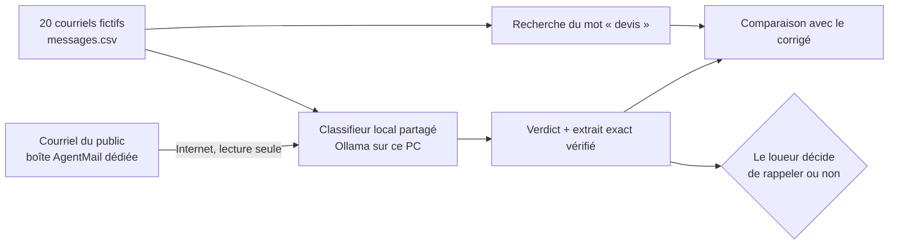

# ☕ AI Coffee · Qui faut-il rappeler pour une nouvelle location ?

Démo locale en français pour une entreprise fictive de location de matériel événementiel en Guadeloupe. Présentation : AI Coffee, jeudi 26 novembre 2026, environ cinq minutes.

## 1. Le problème métier

Un client écrit :

> Bonjour, il nous faudrait 40 chaises pour samedi à Sainte-Anne, vous livrez ?

Il est prêt à louer, sans jamais écrire le mot « devis ». Un autre écrit :

> Je viens de payer le solde du devis accepté en octobre.

Le mot « devis » est là, mais la location est déjà conclue.

**Question posée à la salle : quels messages méritent un rappel pour une nouvelle location, et quels mots de chaque message justifient cette décision ?**

L'application compare deux méthodes sur la même boîte :

1. **Démo préparée** : 20 courriels fictifs, une recherche du mot « devis » face à un modèle local (Ollama), puis le corrigé.
2. **En direct avec AgentMail** : une personne du public écrit à une adresse dédiée ; le présentateur relève le message et le fait classer par le même modèle local.

C'est le loueur qui décide de rappeler. La démo mesure seulement, sur 20 exemples fictifs, combien de vraies demandes chaque méthode retrouve, manque ou signale à tort. Un gain de chiffre d'affaires ou de temps dans une vraie entreprise demanderait un test terrain séparé.



### Où vont les données

| Étape | Où | Internet ? |
|---|---|---|
| Courriels du public | hébergés par AgentMail | oui, pour les relever |
| Classement (les deux onglets) | Ollama, sur ce portable | non |
| Démo préparée complète | ce portable | non, une fois l'installation faite |

Le modèle ne reçoit que l'objet et le corps du courriel. Il ne reçoit ni le numéro du message, ni le corrigé, ni l'expéditeur, et n'a aucun outil pour agir sur la boîte.

------

## 2. Installation (Ubuntu 24.04), une seule fois, avec Internet

Toutes les commandes se lancent **depuis la racine du projet** :

```bash
cd ~/Workspace/102-ai-coffee/ai-coffee-devis
```

### 2.1 uv

```bash
uv --version
```

Succès : `uv 0.13.5` (ou plus récent). Si la commande est introuvable, installe uv pour ton utilisateur selon la [documentation officielle d'Astral](https://docs.astral.sh/uv/getting-started/installation/) :

```bash
curl -LsSf https://astral.sh/uv/install.sh | sh
```

Ouvre un **nouveau terminal**, puis vérifie à nouveau `uv --version`.

### 2.2 Python et dépendances

Le projet fixe Python 3.12 (`.python-version`) et des versions verrouillées (`uv.lock`). uv télécharge Python 3.12 si besoin et crée `.venv/` dans le projet, sans toucher au Python du système.

```bash
uv sync --locked
```

Succès : la commande se termine sans erreur ; `uv run python --version` affiche `Python 3.12.x`.

### 2.3 Ollama et le modèle

```bash
systemctl is-active ollama      # attendu : active
ollama list                     # le modèle gemma4:e2b doit apparaître
```

Si Ollama est arrêté : `sudo systemctl start ollama` (ou `ollama serve` dans un autre terminal).

**Modèle retenu : `gemma4:e2b`** (déjà installé, 4,6 Go, tient dans les 8 Go de la RTX 4060). Comparaison faite le 25/11/2026 sur les 20 messages, sorties JSON contraintes :

| Modèle installé | Demandes retrouvées | Fausses alertes | Citations inventées | Durée (20 messages) |
|---|---|---|---|---|
| `gemma4:e2b` | 4/4 | 0 | 0 | ~3 s chargé, ~13–15 s à froid |
| `deepseek-r1:8b` | 4/4 | 0 | 0 | ~230 s |
| `llama3.2:3b` | 4/4 | 5 | 1 | ~12 s |
| `phi3` | 4/4 | 7 | 3 | ~18 s |

Si `gemma4:e2b` manque sur une autre machine : `ollama pull gemma4:e2b`. Pour imposer un autre modèle par défaut : `OLLAMA_MODEL=nom:tag uv run python app.py` (ou modifier le champ « Modèle local (Ollama) » du panneau « ⚙ Paramètres », en haut à droite de l'écran).

------

## 3. Lancer l'application

```bash
uv sync --locked
uv run python app.py
```

Succès : le terminal affiche `Running on local URL:  http://127.0.0.1:7860`. Ouvre **http://127.0.0.1:7860** dans le navigateur. L'application n'écoute que sur cet ordinateur ; aucun lien public n'est créé. Pour l'arrêter : `Ctrl+C` dans le terminal.

> 💡 **Note** : les identifiants AgentMail viennent de `pass` via le `.envrc` du projet (direnv). Lance donc l'application **depuis un terminal ouvert dans le dossier du projet**. Tant que `direnv allow` n'a pas été fait, direnv affiche `.envrc is blocked` : c'est sans effet sur la démo préparée, qui n'a besoin d'aucun secret.

### 3.1 Premier test, sans AgentMail ni secret

Dans l'onglet **« Démo préparée »** :

L'écran est une file de travail : à gauche la liste des 20 messages fictifs (Nº 01 à 20, objet, statut), à droite le détail du message sélectionné. Clique une ligne (ou `Tab` puis `Entrée`) pour l'ouvrir ; sur téléphone, le détail défile sous la liste et un lien « ← Retour à la liste » permet de remonter.

1. Clique **« 1 · Chercher le mot « devis » »** : les lignes 03, 07, 12, 18 reçoivent l'étiquette « « devis » » et l'en-tête de la liste affiche « 4 contiennent « devis » ».
2. Clique **« 2 · Analyser les 20 messages »** : la progression `n/20` défile et chaque ligne prend son statut. Résultat de la répétition : 02, 07, 13, 17 en ambre **« ● À rappeler »** (« 4 à rappeler » en tête de liste), les autres « Pas une demande ».
3. Clique une ligne « À rappeler » : le détail commence par **« Ce que demande le client »** (la phrase citée par le modèle), puis la prochaine étape, puis le courriel d'origine avec cette phrase surlignée.
4. Clique **« 3 · Révéler le corrigé »** : un panneau compare les méthodes (mot « devis » = 1/4 retrouvée, 3 fausses alertes, 3 manquées ; modèle local = résultat réel de ton analyse) et chaque ligne indique « ✓ Bonne détection », « ✓ Bien écarté », « ✗ Fausse alerte » ou « ✗ Demande manquée ».

Le corrigé reste caché jusqu'à l'étape 4 (bouton « 3 · »). Relancer l'étape 2 efface l'ancien score. « Arrêter l’analyse » marque l'analyse comme incomplète, sans score.

### 3.2 Voir et modifier les prompts (optionnel)

Le bouton **« ⚙ Paramètres »** (en haut à droite) ouvre un panneau latéral avec le champ « Modèle local (Ollama) » et la case **« Afficher et modifier les prompts »**, décochée par défaut : rien n'est projeté tant qu'on ne la coche pas.

- **Prompt système** : les consignes envoyées au modèle avant chaque courriel.
- **Message utilisateur (gabarit)** : `{objet}` et `{message}` y sont remplacés par l'objet et le corps du courriel, encodés en JSON. Aucune autre variable n'est acceptée : le modèle ne peut jamais recevoir le numéro, le corrigé ni l'expéditeur.
- Toute modification efface le score et le corrigé affichés ; le badge **« ▲ Prompts modifiés »** reste visible en en-tête, et l'analyse comme le corrigé indiquent que le score a été obtenu avec des prompts modifiés.
- Un prompt système vide, un gabarit sans `{message}` ou avec une autre variable est refusé avant tout appel au modèle.
- **« Revenir aux prompts d'origine »** rétablit le texte exact. Les modifications ne valent que pour cette fenêtre : rien n'est enregistré, un rechargement de la page rétablit les prompts d'origine.

Exemple pour la salle : remplacer « Exclure offres de fournisseurs, suivi de location déjà conclue, annulations et SAV. » par « Toute question posée au loueur compte comme une demande. » donne 7 rappels dont 3 fausses alertes (09, 15, 19) au lieu de 4/4 : le prompt fait la règle.

### 3.3 Activer l'onglet en direct

Quand le premier test fonctionne, configure la boîte dédiée en suivant **[docs/AGENTMAIL.md](docs/AGENTMAIL.md)** (création de la boîte, secrets dans `pass` exportés par `.envrc` via direnv, test de connexion, premier message).

### 3.4 Arrêter l'application

Dans le terminal où tourne `uv run python app.py`, appuie sur **`Ctrl+C`**. Le terminal reprend la main ; la page du navigateur ne répond plus.

Si ce terminal a été fermé ou si l'application a été lancée ailleurs (le port 7860 reste occupé) :

```bash
# Show which process listens on port 7860
ss -ltnp | grep 7860
# Stop it gracefully (works the same as Ctrl+C)
pkill -f "python app.py"
# Check: no output means the port is free
ss -ltn | grep 7860
```

**Libérer le port 7860** si `pkill` ne suffit pas, ou si le port est pris par un autre programme :

```bash
# Show the process holding port 7860 (PID and command)
lsof -i :7860
# Ask every process on port 7860 to stop (TERM signal, clean shutdown)
fuser -k -TERM 7860/tcp
# Last resort if it still answers after a few seconds: force kill
fuser -k -KILL 7860/tcp
# Check: no output means the port is free
ss -ltn | grep 7860
```

> ⚠️ **Warning** : `fuser -k` arrête **tout** processus sur ce port. Regarde d'abord ce qu'affiche `lsof`. Si ce n'est pas l'application, choisis plutôt un autre port : `GRADIO_SERVER_PORT=7861 uv run python app.py`, puis ouvre http://127.0.0.1:7861.

Les messages relevés en direct sont perdus à l'arrêt (ils restent dans AgentMail et reviennent au prochain « Relever ») ; le modèle reste chargé dans Ollama pendant 30 minutes.

------

## 4. Avant de monter sur scène

- [ ] Ordinateur sur secteur ; écran dupliqué sur le projecteur.
- [ ] Terminal ouvert dans le projet, direnv chargé (`direnv: export +AGENTMAIL_API_KEY +AGENTMAIL_INBOX_ID`), puis `uv run python app.py` lancé, page ouverte, zoom du navigateur à 125 %.
- [ ] Une analyse complète faite dans les 30 minutes précédentes (le modèle reste chargé 30 min ; sinon le premier passage prend ~15 s au lieu de ~3 s). Puis recharge la page (`F5`) pour repartir d'un écran vierge.
- [ ] Onglet « En direct avec AgentMail » : clique « Relever les nouveaux messages » une fois pour confirmer l'adresse affichée.
- [ ] Capture d'écran d'un résultat réel de répétition gardée dans un onglet, au cas où.

------

## 5. Script de présentation (5 minutes)

| Temps | Action à l'écran | À dire |
|---|---|---|
| 0:00 | Onglet « Démo préparée », écran vierge | « Imaginez : vous louez du matériel événementiel en Guadeloupe. Un client écrit : *il nous faudrait 40 chaises pour samedi à Sainte-Anne, vous livrez ?* Un autre : *je viens de payer le solde du devis accepté en octobre.* Lequel faut-il rappeler pour une nouvelle location ? Et quels mots le prouvent ? » |
| 0:40 | Montre la liste des 20 messages, puis **« 1 · Chercher le mot « devis » »** | « La méthode classique : chercher le mot devis. Quatre résultats. Lesquels appellent vraiment une proposition ? » (03 dossier classé, 12 déjà payé, 18 un garage.) |
| 1:20 | **« 2 · Analyser les 20 messages »** | « Maintenant un modèle d'IA qui tourne sur ce portable, sans Internet. » Pendant le calcul : « 02 et 08 parlent tous deux de livraison. Lequel cherche encore à louer ? » |
| 1:50 | Clique une ligne ambre « À rappeler » (02, par exemple) | Lis « Ce que demande le client », puis montre la même phrase surlignée dans le courriel d'origine : « Chaque suggestion doit citer une phrase exacte, vérifiée par le programme. » |
| 2:20 | **« 3 · Révéler le corrigé »** | Compare les deux lignes du tableau (et les marques ✓/✗ de la liste) : demandes retrouvées, fausses alertes, demandes manquées. Si le modèle s'est trompé : « Quelle phrase a pu l'induire en erreur ? » |
| 2:50 | Onglet **« En direct avec AgentMail »** | **Invite le public** : « À vous. Écrivez un message fictif à cette adresse, sans signature. Une demande de location… ou un piège. » Laisse l'adresse à l'écran 30 à 45 s. |
| 3:40 | **« Relever les nouveaux messages »**, puis clique un message dans la liste | Il s'affiche à droite (objet et texte, jamais l'expéditeur) : lis-le. Réessaie après 20 s si « Aucun nouveau message ». |
| 4:05 | **« Analyser ce message avec le modèle local »** | « Même modèle, même règle. » Demande à l'expéditeur : « Le modèle a-t-il compris votre intention ? » |
| 4:35 | Conclusion | « Le modèle trie et cite ses preuves ; c'est le loueur qui décide qui rappeler. Ici on a mesuré 20 exemples fictifs. Pour savoir si ça fait gagner du temps ou des ventes, il faudrait l'essayer sur de vrais messages pendant quelques semaines. » |

**Si la salle n'a pas Internet** : reste sur « Démo préparée » (tout y fonctionne hors ligne). À 2:50, remplace le direct par un débat : « Écrivez sur un papier un message qui piégerait le mot-clé » et commente-le ; ou montre la capture d'un message réel relevé pendant la répétition, en disant que c'est une capture. Le retour à l'onglet « Démo préparée » ne nécessite aucun redémarrage.

------

## 6. Dépannage

| Symptôme à l'écran | Cause | Action |
|---|---|---|
| « Ollama ne répond pas sur 127.0.0.1:11434 » | service arrêté | `sudo systemctl start ollama`, puis relance l'étape 2 |
| « Modèle « … » introuvable dans Ollama » | nom mal saisi | remets `gemma4:e2b` dans le champ « Modèle local (Ollama) » du panneau « ⚙ Paramètres » ; vérifie `ollama list` |
| Analyse lente (> 20 s) | modèle déchargé, ou autre modèle occupant la carte | attends le premier passage ; `ollama ps` puis `ollama stop <autre-modèle>` |
| Ligne « ⚠️ À vérifier : citation introuvable » | le modèle a cité une phrase absente du courriel | c'est une erreur d'analyse, comptée comme non retenue ; le dire au public |
| « Analyse interrompue » / « Analyse arrêtée » | échec ou clic sur Arrêter | aucun score n'est gardé ; relance l'étape 2 |
| `Address already in use` au lancement | une autre instance tourne déjà | arrête-la (section 3.4), ou `GRADIO_SERVER_PORT=7861 uv run python app.py` et ouvre http://127.0.0.1:7861 |
| `uv sync --locked` échoue (« lockfile needs to be updated ») | `pyproject.toml` modifié à la main | `uv lock`, puis `uv sync --locked` |
| Problèmes AgentMail | voir le tableau de diagnostic | [docs/AGENTMAIL.md](docs/AGENTMAIL.md#7-diagnostic) |

Tests automatiques (corpus, mot-clé, citations, connecteur AgentMail simulé) : `uv run pytest -q`.

## 7. Fichiers

| Fichier | Rôle |
|---|---|
| `app.py` | point d'entrée et interface Gradio (deux onglets) |
| `core.py` | corpus, recherche du mot-clé, classifieur Ollama partagé, score |
| `live_inbox.py` | lecture seule de la boîte AgentMail dédiée |
| `messages.csv` | les 20 courriels fictifs (corrigé : 02, 07, 13, 17) |
| `.envrc` | exporte `AGENTMAIL_API_KEY` et `AGENTMAIL_INBOX_ID` depuis `pass` (direnv), sans secret dans le fichier |
| `docs/AGENTMAIL.md` | configuration et test de la boîte dédiée |
| `docs/STACK.md` | technologies utilisées, versions, rôle et raison du choix |
| `docs/architecture.md` · `docs/development.md` | modules et flux · commandes, tests et conventions de développement |
| `CLAUDE.md` | consignes pour les agents de code (règles à ne pas casser) |
| `.pre-commit-config.yaml` · `.yamllint.yaml` | contrôles avant commit (fichiers, YAML, clés privées, scripts shell, secrets avec gitleaks, Ruff de `uv.lock`) |
| `.github/workflows/ci.yml` | CI GitHub : formatage, qualité (Ruff), tests, recherche de secrets (gitleaks) |
| `LICENSE` | licence MIT |
| `docs/adr/` | décisions d'architecture (ADR 0001 à 0010), index dans `docs/adr/README.md` |

Inspiration : https://docs.redhat.com/en/learn/ai-quickstarts/rh-helpdesk-email-triage
